# 📸 Screenshots

Every image is a real window of Hypertune, captured on a 1920×1080 desktop; the layout is unchanged in v8.6.56. Click one to view it full size.

## Start board

| | |
|---|---|
| 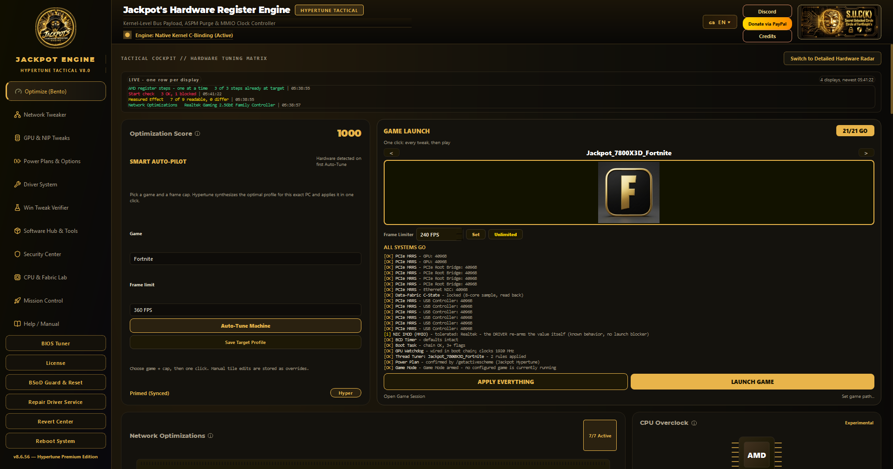 *One score, one switch, the readiness checklist and Smart Auto-Pilot in one view* | 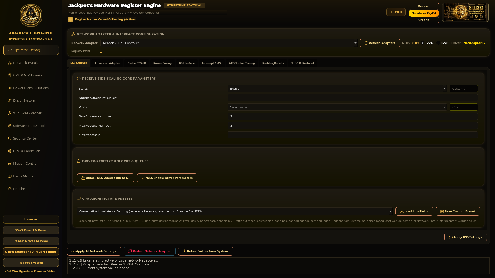 *Receive-side scaling: distribution across cores, presets, live read-back* |

## Network tweaker (S.U.C.K. Protocol)

| | |
|---|---|
| 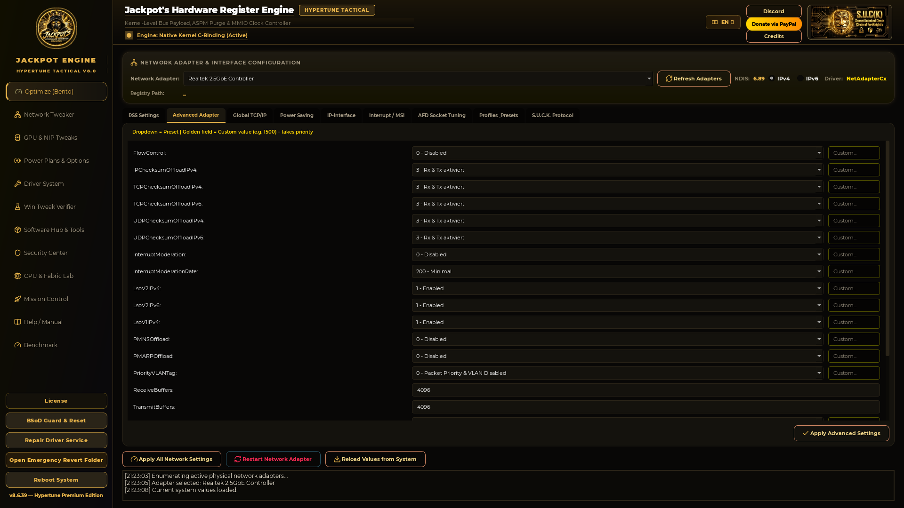 *Per-adapter offload and interrupt moderation, with a custom value where the driver allows one* | 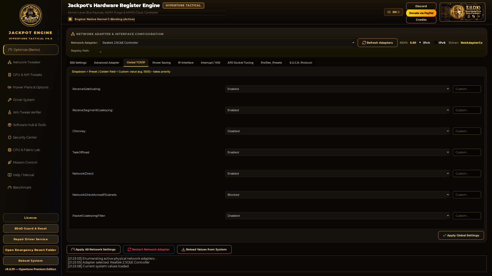 *Stack-wide TCP/IP and offload settings* |

## Hardware and power

| | |
|---|---|
| 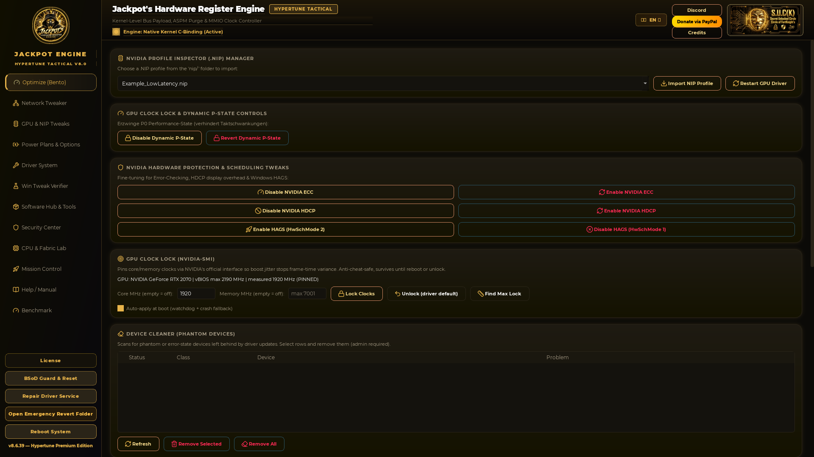 *Frame limiter, clock pinning and driver hygiene — every value read back* | 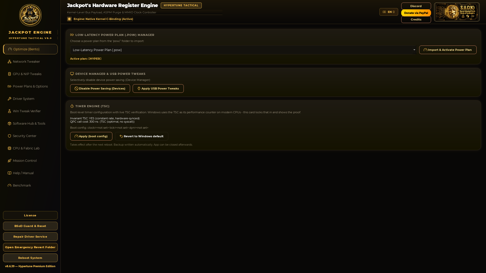 *Power plan import and the timer engine with its measured TSC state* |
| 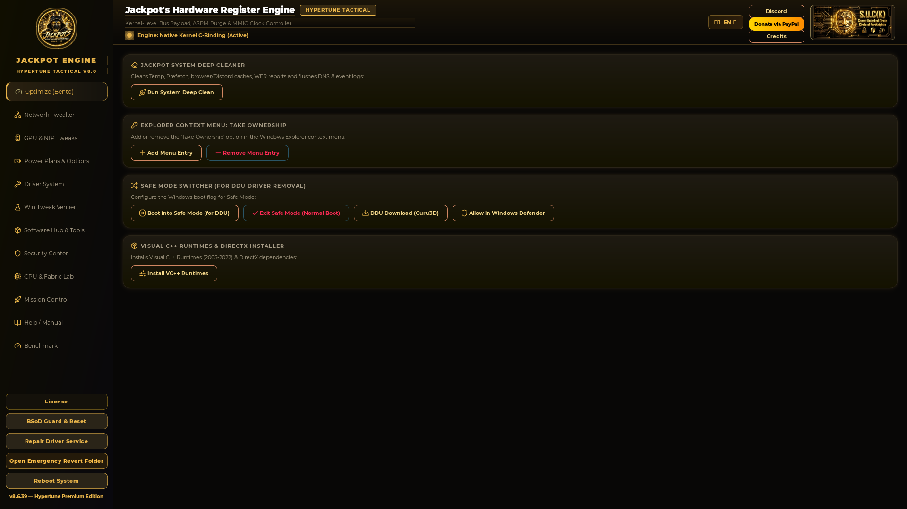 *Driver service repair, cleanup and runtime maintenance* | 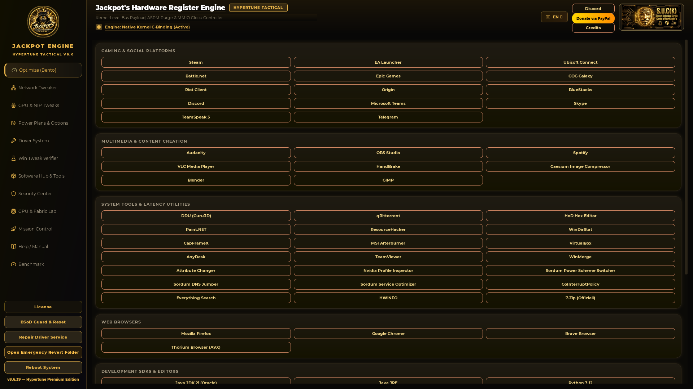 *Curated downloads, grouped by purpose* |

## Session control

| | |
|---|---|
| 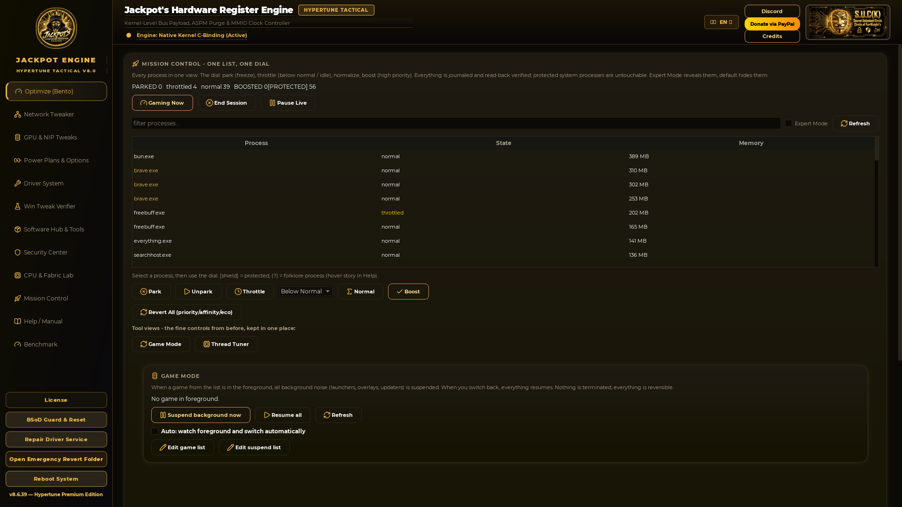 *One process list, one dial: park, throttle, normalize, boost — journaled and reversible* | 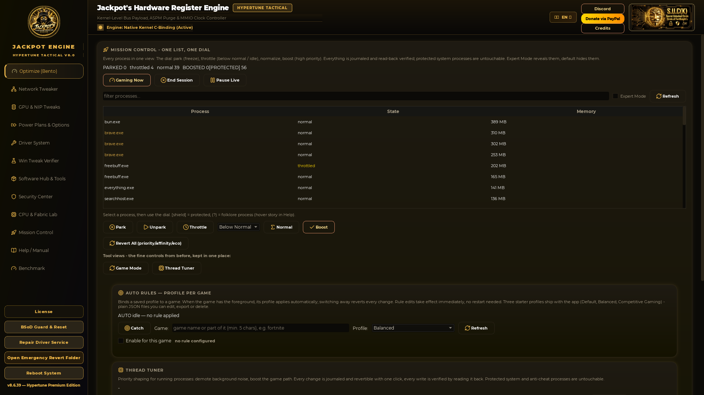 *A saved rule set per game, applied when the game takes focus* |

## Verification

| | |
|---|---|
| 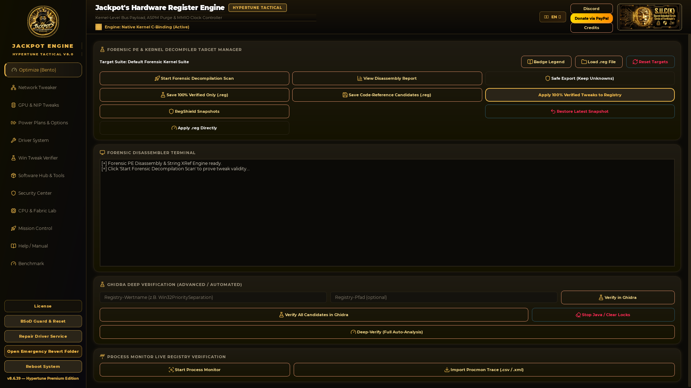 *Static analysis instead of belief: is a value actually read by the code that should read it?* | |
