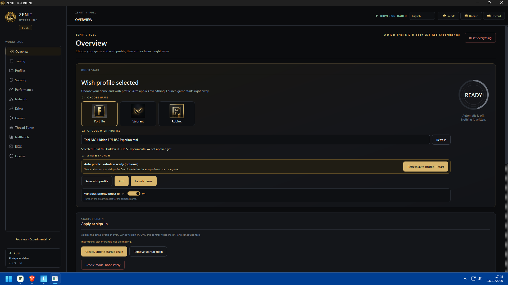
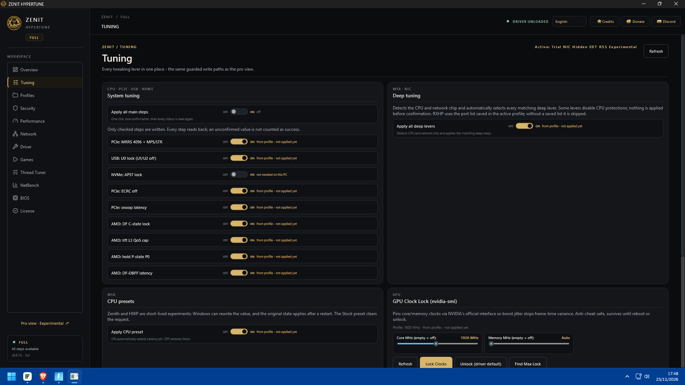
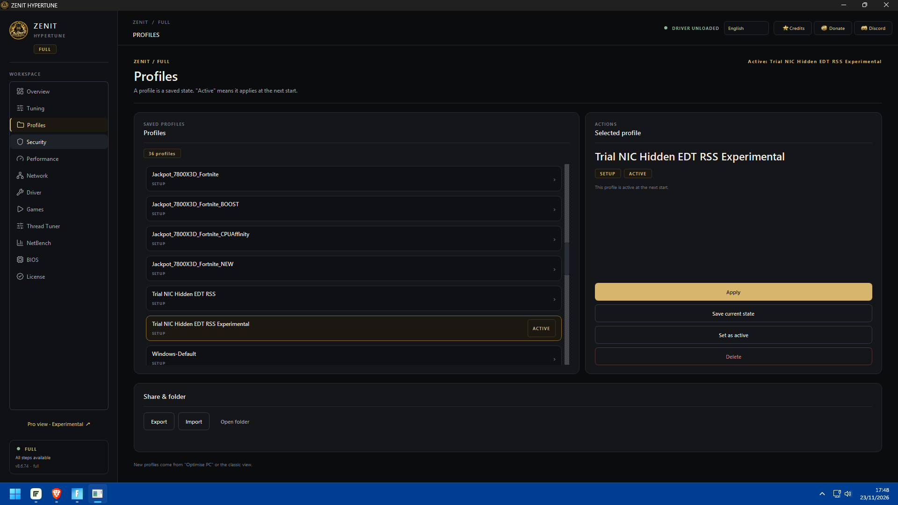
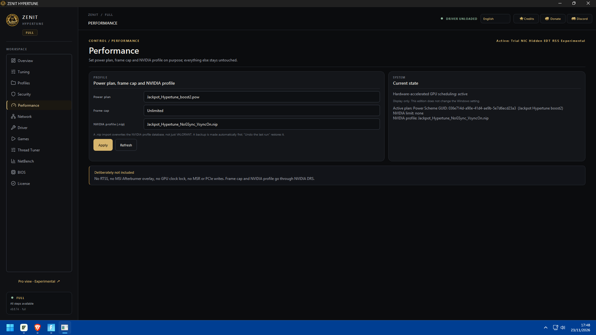
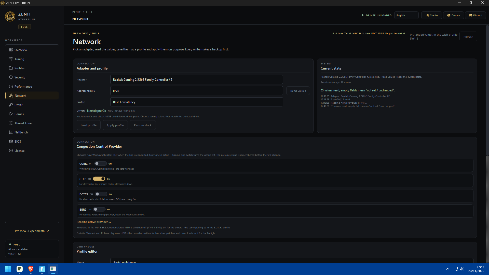
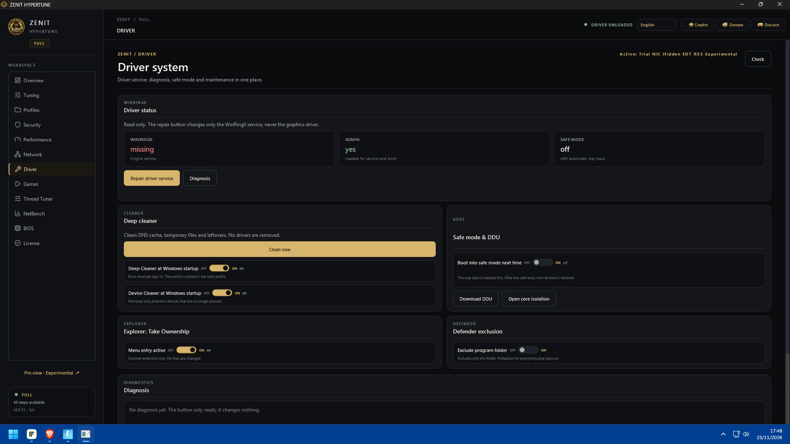
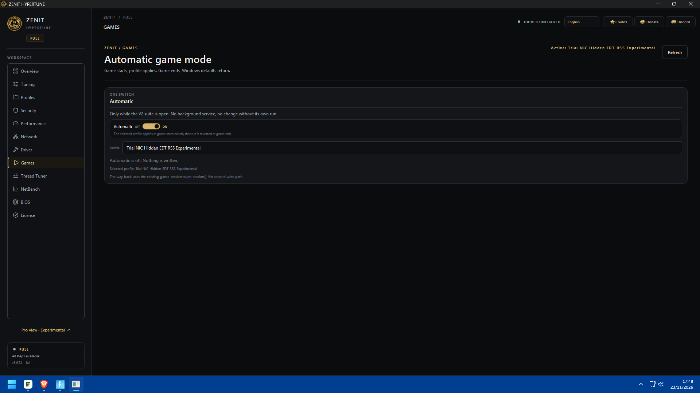
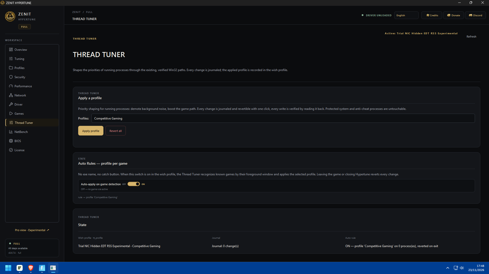
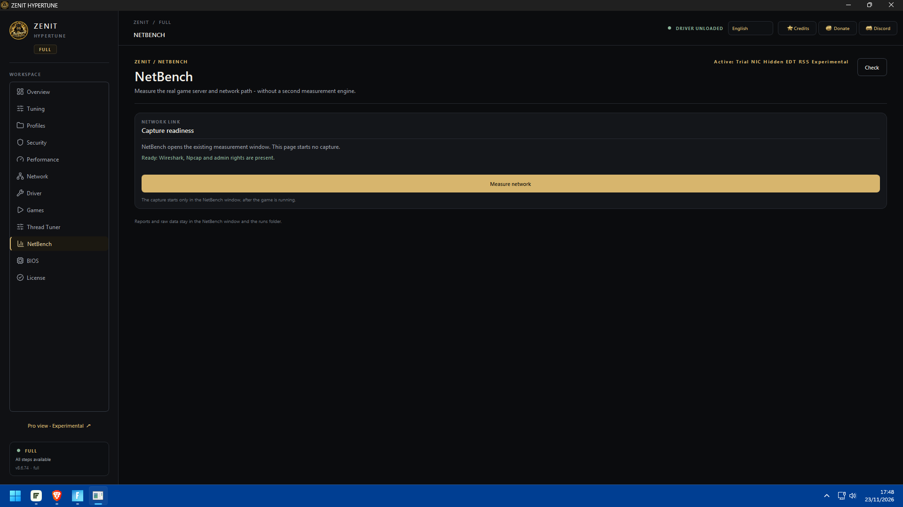
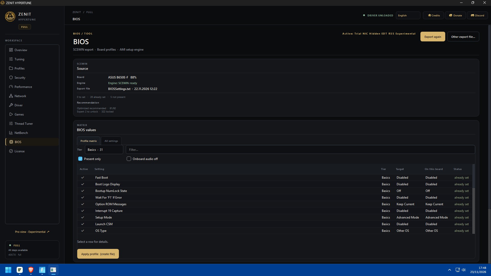

# 📸 Screenshots

Every image is a real window of Hypertune v8.6.74, captured on a 1920×1080 desktop in the new UI-v2. Click one to view it full size.

Source for all 11 shots: green UI run `ae37ad778c67` from 23.11.2026 (12 pages visited, 8/8 steps, 28 profiles). The gallery shows 11 pages of the new UI.

## Overview

| | |
|---|---|
|  *Choose game and wish profile, then arm or launch — one state per game* |  *Every step explains itself; steps that do not fit this machine stay visible but off* |

## Profiles and security

| | |
|---|---|
|  *Saved profiles match what was applied, including the network choices* |  *Snapshots before every write, one click back* |

## Performance and network

| | |
|---|---|
|  *Power plan, frame cap and NVIDIA profile on purpose, everything else untouched* |  *Adapter profile with read-back; congestion provider in plain words* |

## Driver and games

| | |
|---|---|
|  *Driver service repair, cleanup and runtime maintenance* |  *Games as executable, launcher URI or shortcut — remembered across reboots* |

## Tuning helpers

| | |
|---|---|
|  *A saved rule set per game, applied when the game takes focus* |  *Latency measurement with honest reporting* |

## BIOS

| | |
|---|---|
|  *BIOS import and export with a readable way back* | |
